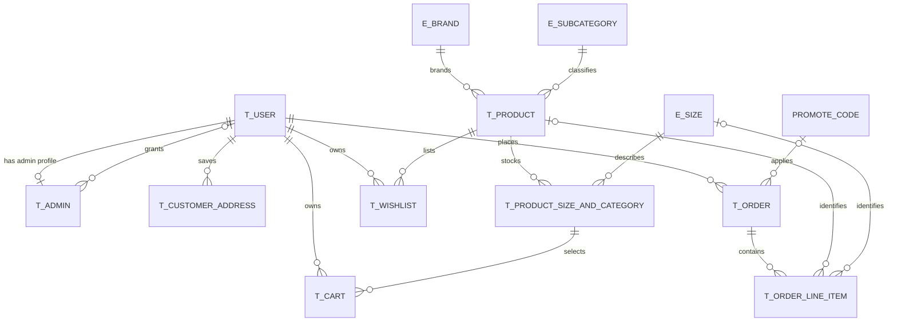

# SneakerPeak database redesign for review

The [proposed SQL schema](database/proposed-schema.sql) is the table-by-table definition, including column types, defaults, primary keys, unique constraints, foreign keys, explicit indexes, and delete behavior. It targets a new, empty database after approval. The configured database and the baseline dump were inspected read-only. This phase includes no database or PHP changes.

## Baseline and live comparison

The live XAMPP database reports MariaDB 10.4.28. All 12 tables match the dump on column names, types, nullability, and primary-key membership. The live schema has zero foreign keys and zero secondary indexes. Counts below describe the live snapshot and should be collected again from the frozen source before rehearsal.

| Legacy table | Live rows | Proposed destination |
| --- | ---: | --- |
| customer | 7 | T_User and T_CustomerAddress |
| admin | 5 | T_User and T_Admin |
| brand | 5 | E_Brand |
| sub_category | 6 | E_SubCategory |
| product | 65 | T_Product |
| sizeandqty | 365 | E_Size and T_ProductSizeAndCategory |
| oder | 32 | T_Order |
| oder_details | 77 | T_OrderLineItem |
| oder_address | 62 | Shipping snapshot columns on T_Order |
| cart | 2 | T_Cart |
| wishlist | 11 | T_Wishlist |
| promote_code | 15 | T_Promotecode |

## Entity relationships

The diagram labels use uppercase names for readability. Use the exact table names in the SQL when configuring PHP on case-sensitive hosts. InnoDB will create supporting foreign-key indexes where no listed index already covers the key. Accounts and products normally deactivate rather than delete. Orders restrict deletion of their owners and lines restrict deletion of orders. Nullable line references can be cleared while retaining snapshots. Saved addresses, cart items, and wishlist entries cascade only when an otherwise deletable user is physically removed.

## Decisions and old-to-new mapping

| Legacy table | Conversion and exceptions |
| --- | --- |
| customer | Allocate a new T_User.Id and write a mapping keyed by legacy customer ID. Copy name, email, phone, image, and verified status. Use the original email for display and a normalized, trimmed, case-folded EmailKey for identity and sign-in. Keep recognized, supported password hashes. Require a password reset for plaintext or unknown formats, and invalidate legacy codes. Populate saved address slots 1 and 2 only from nonblank customer fields. The snapshot has seven populated first slots and one second slot. Leave recipient fields blank unless their provenance is established. |
| admin | Use a separate legacy admin ID map. Copy common name, email, phone, password, and image fields to T_User. Create a T_Admin extension for role metadata, with unknown grant date or grantor left null. No numeric ID overlaps or normalized email duplicates were found within or across roles. On rerun, review duplicates manually, keep original IDs in staging, and approve an explicit merge or distinct login before import. Matching email alone cannot grant admin privileges. |
| brand | Map Brand_ID to BrandId and preserve name and logo. Resolve normalized name collisions explicitly before importing products. |
| sub_category | Map SC_ID to SubCategoryId. Trim labels used by legacy joins and review any normalized collisions. |
| product | Map Prod_ID to ProductId. Resolve brand and subcategory through their reviewed lookup maps. Map Male, Female, and Kid to Audience and preserve descriptions, image filenames, colour, prices, and display status. Translate available to AVAILABLE and Deleted to DEACTIVATED. Resolve writes and links by ProductId. Product name is indexed and can be edited independently of references. |
| sizeandqty | All 365 Prod_ID values are blank. Resolve stock by unique trimmed product name and normalized size, then retain the legacy stock ID in the reconciliation map. Six rows lack a matching product name. Two duplicate name/size groups have two rows each. One has identical quantities and statuses and needs approval to collapse. The other has conflicting quantities and needs an authoritative count. Never add the quantities together automatically. Keep availability separate from quantity; sellable stock requires both an enabled row and positive Qty. |
| oder | Allocate T_Order.Id from the source ID mapping. Resolve UID through the customer map only. Keep Order_code as an external reference; no duplicate codes were found in the live snapshot. Three orders have no valid customer. Quarantine pending review or use explicitly approved, inactive, non-login historical owners with documented source-ID mappings. Preserve item amount, shipping, currency, payment method/status, fulfilment status, and the ask flag. Map a recognized promotion to PromotecodeId and retain the source code snapshot, including when no current promotion matches. |
| oder_details | Link by reviewed exact (UID, Order_code) and use the legacy line ID for retry identity. Preserve quantity, recorded date, unit purchase price, product name, and size snapshots. Resolve nullable product and size references only when unambiguous. One line has no matching current product name. Forty lines have no exact parent or code-only parent in the live snapshot. Keep their original IDs and values in restricted staging, seek source backups, and require a reviewed disposition before cutover. |
| oder_address | Match by exact (UID, Order_code), then copy address, recipient, and phone to the order snapshot. Of 62 rows, 23 lack both an exact and code-only parent. Eleven groups have multiple rows for the same source key, and 29 orders have at least one exact snapshot candidate. Identical duplicates may collapse with recorded provenance. Conflicting snapshots require review because these source rows lack timestamps. Do not populate saved addresses from shipping history. Orders with no verified snapshot keep the snapshot fields null. |
| cart | Migrate to T_Cart. Resolve UID through the customer map and the product name and size through the approved stock map. Store quantity and references. Read current product images and prices from T_Product. Both live rows have a customer and a stock-name/size candidate. Quarantine missing, ambiguous, or invalid items and reconcile duplicate quantities or stock shortfalls before import. |
| wishlist | Map wish_id to T_Wishlist.Id. Resolve UID through the customer map and prod_name by unique normalized product name. Pimg1 is supporting evidence for ambiguous candidates and is omitted from the target. There are five rows with invalid users and zero unmatched product names or duplicate user/product groups. Flag any unresolved rows before import. List through a product join using current name/image. Add and remove by ProductId and authenticated UserId. |
| promote_code | Migrate to T_Promotecode. Map the source id to T_Promotecode.Id, normalize and uniquely resolve the code, and preserve details, active status, and expiry. Translate Value Off to FIXED, Percentage Off to PERCENTAGE and Free Shipping to FREE_SHIPPING. Validate decimal amounts, percentage range, and actual date parsing. Preserve order links separately from the order's code snapshot. |

The current stock labels are numeric strings from 3.5 through 12 with gaps. The live inventory has no size-system field. The storefront size-chart page uses multiple standards, so do not infer a single system from the number alone. Propose importing verified labels with an UNSPECIFIED system and numeric display ordering until a product-by-product or brand-specific rule is confirmed. Support UK, US, EU, and future systems in the lookup. Keep SubCategoryId and Audience on T_Product. The data shows no size-specific categories. Use the requested T_ProductSizeAndCategory name provisionally and enforce one row per product and size **after** resolving the observed duplicate groups.

Admin authorization requires an active T_User with IsAdmin enabled and a matching T_Admin record. The composite FK blocks an admin extension from referencing a non-admin flag. The reverse direction is enforced by using a dedicated, restricted role-management operation since a standard check constraint cannot require a row in another table. Grant by locking the user row, setting IsAdmin true, and inserting the extension in one transaction. Revoke by locking the row, deleting its extension, and setting IsAdmin false in one transaction. Restrict direct writes to role fields, reject inconsistent roles on read, invalidate existing elevated sessions on revocation, and reconcile both directions before cutover. Confirm the approved grant/revoke operator policy, including how to bootstrap and protect the last admin.

### Money, dates, and audit fields

Use finite, exact decimal conversions for prices and totals. The current CheckoutService stores its quoted total minus shipping in Order_TotalAmmount and writes shipping separately. Move those two numeric values independently, retain original raw amounts in staging, and compare historical source invoices before treating all older records as net plus shipping. Never reconstruct a historical order amount from today's product price or retroactively apply a promotion. Keep the order code and order-line snapshots stable across catalog changes.

Every table has UTC DATETIME(6) CreatedDate and AdjustedDate. Both use the current session timestamp at insert; AdjustedDate advances when stored values change. Set the session timezone to UTC and preserve reliable historical timestamps if any become available. This source stores dates without time for orders and lines, so preserve those as OrderedOn and RecordedOn rather than inventing exact event times. For missing audit timestamps use the same documented UTC migration batch timestamp for both fields, with provenance recorded under the legacy ID. A retry uses the original batch timestamp and must not touch unchanged rows. Use strict day/month/year parsing with an approved separator list, calendar validation and round-trip checks. Invalid or ambiguous values go to the exception report.

## Approval and migration sequence

1. Approve the draft schema, snapshot selection policy, stock conflicts, sizing-system policy and role management. Retake the read-only inventory from the source snapshot. Take a protected, restorable backup and save table definitions, row counts, key totals, and hashes. Keep sensitive data and row-level exception reports outside the repository and web root.
2. Restore the backup to an isolated local staging database. Capture baseline assertions and approved decisions using (source table, source primary key). Keep immutable raw rows, mapping tables, and quarantine outside the application schema. Assign a stable snapshot ID and migration audit timestamp. A new, empty local target receives the reviewed DDL. Confirm the server enforces CHECK and FK constraints before importing.
3. Import users, admin extensions, brands, subcategories and sizes. Then import products, inventory, saved addresses and promotions. Import orders with reviewed shipping snapshots, order lines, carts and wishlists. Resolve every dependency through recorded IDs or approved matches. Disable any external mail or payment calls during rehearsal.
4. Use unique staging keys (snapshot ID, source table, legacy ID) and durable target mappings. Commit each target batch and its mapping together using InnoDB. Update only reviewed changed records and assign inventory from the reconciled quantity rather than incrementing it. Explicitly map equivalent duplicate rows to a shared target ID. Rerun after a deliberately interrupted local import and after a completed import; check counts, stock, timestamps, and row hashes for stability. Do not run checkout or apply migration by replaying order mutations.
5. Reconcile each source count against imported rows, approved merges, exceptions and unresolved rows. Verify every FK and both role directions. Compare per-order amounts, shipping fees, prices, and quantities, plus inventory and availability by product and normalized size. Compare the exact shipping address, recipient and phone for approved snapshots, then edit/delete a saved address in the copy and confirm prior snapshots stay intact. Verify customer versus admin access, grant/revoke, reset/verification, catalog, promotion eligibility, cart, wishlist and complete demo checkout on the copy. Preserve a signed-off exception report for unresolved historical records. Cutover is blocked until their treatment is approved.
6. After a successful rehearsal and explicit cutover approval, freeze writes, back up again and repeat the tested import into the empty target. Compare final reconciliation before switching PHP and connection settings together. Keep the original database read-only during verification and retain a tested rollback route. If target writes have already started, freeze them and preserve a delta for reconciliation before rollback. Do not drop the source as part of this cutover.

## PHP queries and workflows affected

| Workflow | Query and caller changes |
| --- | --- |
| Sign-in, identity and admin access | AuthController lookup and insert branches, AuthService password verification and upgrades, PasswordResetService code persistence, ProfileController profile changes, RequireSession session IDs and roles, Admin/CustomerController, and admin add-account views. Replace separate customer/admin lookup paths with UserId and verified effective role. Prepare a reviewed short-lived token store for reset and verification before replacing legacy code columns; do not persist current numeric codes in T_User. Reissue authenticated sessions at cutover. |
| Catalog, product assets and inventory | ProductModel browse/details/sizes, CatalogController lookups, ProductDetailsController, Admin product controllers and add-brand/add-product views. Update name and status predicates, lookup joins, stock filters, inventory locks and edit paths to use IDs. Review old search/filter scripts including Search, filter, filterlist, get_products and newone before retiring or migrating them. |
| Cart and promotions | CartModel reads and mutations, CartController, ProductDetailsController, Legacy plus/minus and image helpers, PromotionModel, CheckoutService quotation and admin promotion view. Replace UID and name/size joins with UserId and stock IDs, preserve live pricing, validate query indexes, and keep checkout atomic. |
| Order, address, payment and reporting | AddressController and Legacy/fetch_address read saved slots and write order snapshots, CheckoutService creates orders and lines and completes inventory changes, PaymentController and OrderModel read status and history, OrderController renders invoices and receipts. Admin OrderController, OrderDetailsController, OrderStatusController, Legacy/updateask, DashboardController, ReportingModel, and linechar use OrderId, snapshot fields, numeric money and real dates. Keep externally visible OrderCode stable. |
| Wishlist | WishlistModel add/list and the legacy delete endpoint, HomeController, CatalogController, WishlistController, and homepage, catalog and wishlist links/forms. Join T_Product for display and use ProductId plus the current UserId for all mutations. Validate duplicate additions and customer isolation. |

Additional decisions for review include the proposed email normalization and password reset policy, nullable historical links and archival retention, how to store reset tokens, date and exchange/currency rules if non-MYR history appears, and any compatibility URL plan during PHP cutover. The proposed DDL has been inspected but has not been applied or rehearsed in this review phase.
